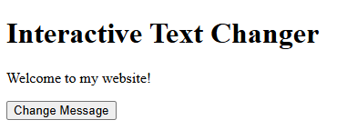
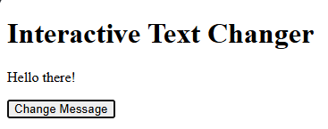
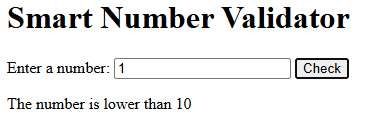
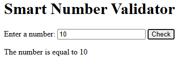
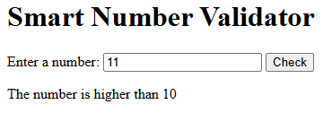
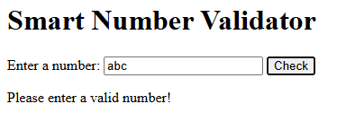
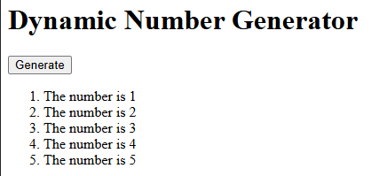

# BIC21203 Lab 4a - Client-Side Scripting (JavaScript)

**Name:** MUHAMMAD AKMAL ARFAN BIN NIZAM
**Student ID:** CI250141

## Brief Explanation
This lab uses plain HTML5 and JavaScript to practise DOM manipulation,
event handling, conditional statements and loops. Each question is in
its own folder with an `index.html` and a `script.js` file.

## Live Pages
- Q1: https://muhammadakmalarfan.github.io/LAB4A/Q1/
- Q2: https://muhammadakmalarfan.github.io/LAB4A/q2/
- Q3: https://muhammadakmalarfan.github.io/LAB4A/Q3/

## How to Run

### Q1 - Interactive Text Changer
1. Open the `q1` folder and open `index.html` in a web browser.
2. Click the **Change Message** button.
3. The text changes from "Welcome to my website!" to "Hello there!".

### Q2 - Smart Number Validator
1. Open the `q2` folder and open `index.html` in a web browser.
2. Type a value in the input box and click **Check**.
3. The page says whether the number is lower than, higher than, or equal
   to 10. Empty or non-numeric input shows "Please enter a valid number!".

### Q3 - Dynamic Number Generator
1. Open the `q3` folder and open `index.html` in a web browser.
2. Click **Generate**.
3. A numbered list from 1 to 5 appears. Clicking again does not
   duplicate the list.

## Screenshots

### Q1
Before clicking:

After clicking:

### Q2
Input 5:

Input 10:

Input 15:

Invalid input:

### Q3
After clicking Generate:

